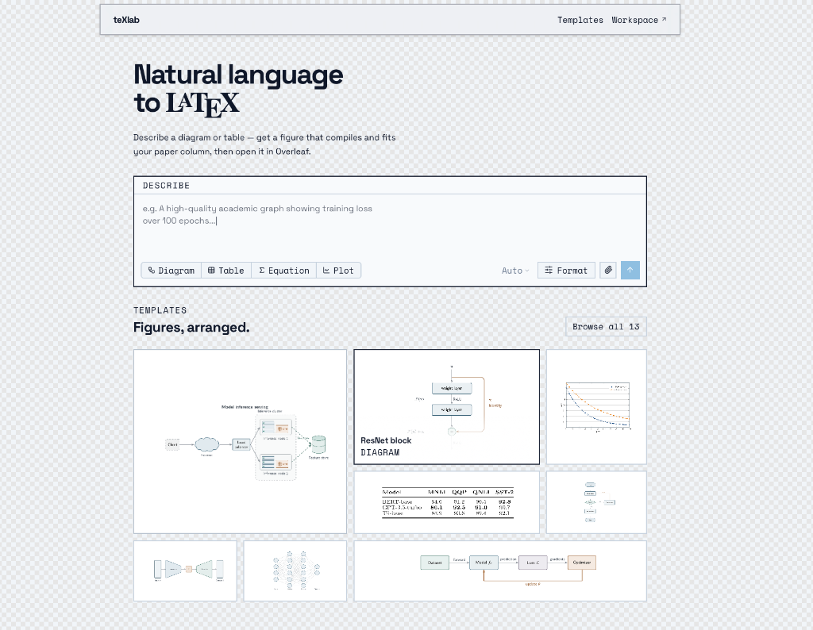
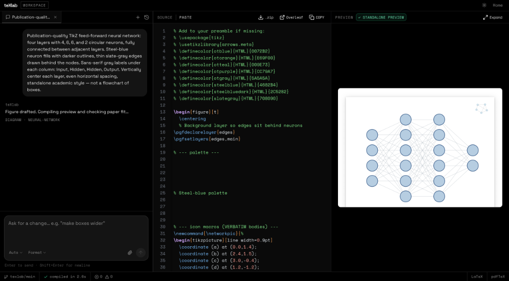
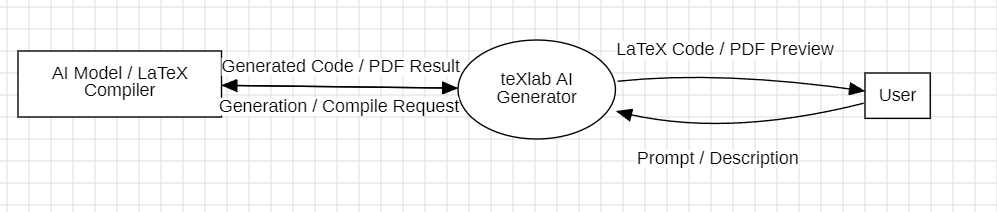
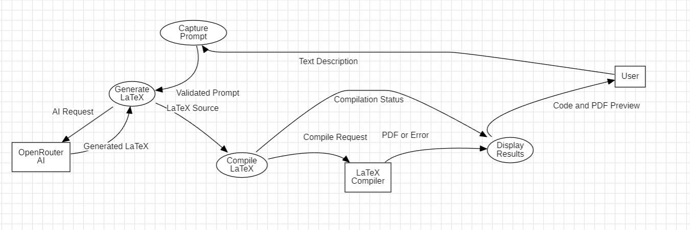
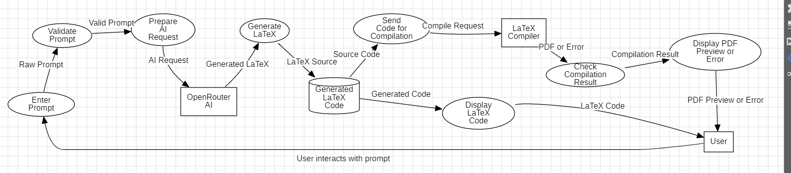
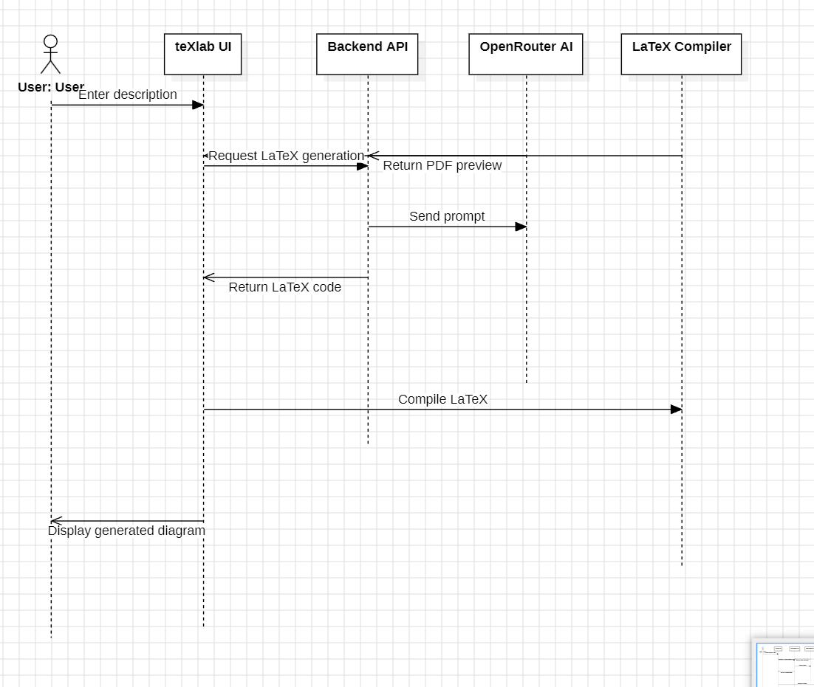
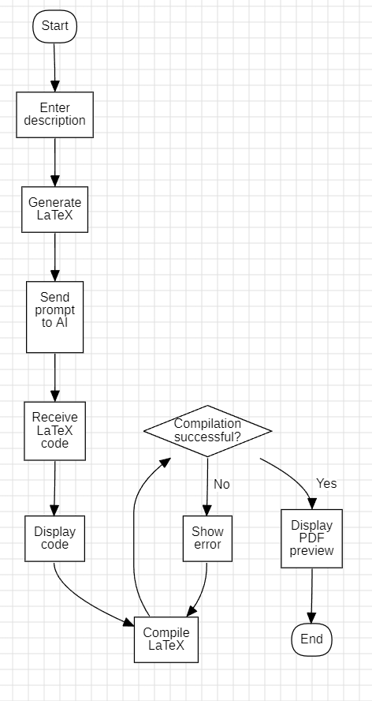
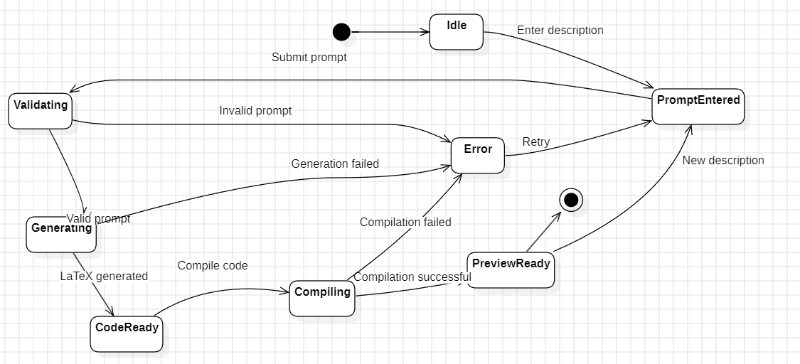
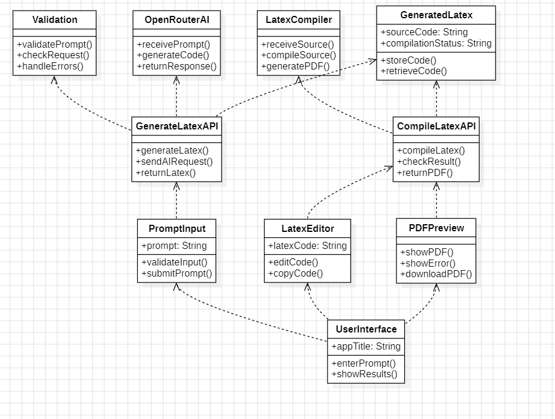
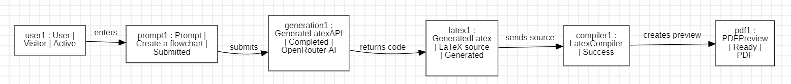

# Software Requirements Specification
## for
# texlab

**Version 1.0 approved**  
**Prepared by Aryan Rastogi (2427030083) & Raghav Sethi (2427030127)**  
**texlab Organization**  
**October 20, 2026**

---

## Table of Contents
- [Revision History](#revision-history)
- [1. Introduction](#1-introduction)
  - [1.1 Purpose](#11-purpose)
  - [1.2 Document Conventions](#12-document-conventions)
  - [1.3 Intended Audience and Reading Suggestions](#13-intended-audience-and-reading-suggestions)
  - [1.4 Product Scope](#14-product-scope)
  - [1.5 References](#15-references)
- [2. Overall Description](#2-overall-description)
  - [2.1 Product Perspective](#21-product-perspective)
  - [2.2 Product Functions](#22-product-functions)
  - [2.3 User Classes and Characteristics](#23-user-classes-and-characteristics)
  - [2.4 Operating Environment](#24-operating-environment)
  - [2.5 Design and Implementation Constraints](#25-design-and-implementation-constraints)
  - [2.6 User Documentation](#26-user-documentation)
  - [2.7 Assumptions and Dependencies](#27-assumptions-and-dependencies)
- [3. External Interface Requirements](#3-external-interface-requirements)
  - [3.1 User Interfaces](#31-user-interfaces)
  - [3.2 Hardware Interfaces](#32-hardware-interfaces)
  - [3.3 Software Interfaces](#33-software-interfaces)
  - [3.4 Communications Interfaces](#34-communications-interfaces)
- [4. System Features](#4-system-features)
  - [4.1 Natural Language to LaTeX Generation & Multimodal Input](#41-natural-language-to-latex-generation--multimodal-input)
  - [4.2 Fine-Grained Generation Preferences Steering](#42-fine-grained-generation-preferences-steering)
  - [4.3 Automated Prompt Keyword & Style Detection](#43-automated-prompt-keyword--style-detection)
  - [4.4 Interactive Dual-Pane Workspace & Live Compilation Preview](#44-interactive-dual-pane-workspace--live-compilation-preview)
  - [4.5 Remote LaTeX Compilation Proxy & Log Capture](#45-remote-latex-compilation-proxy--log-capture)
  - [4.6 Autonomous Compile-Error Diagnostics & Multi-Pass Auto-Repair](#46-autonomous-compile-error-diagnostics--multi-pass-auto-repair)
  - [4.7 Raster-Based Column Fit Validation & Auto-Fit Refinement](#47-raster-based-column-fit-validation--auto-fit-refinement)
  - [4.8 Curated Figure Template Library & Parametric Editing](#48-curated-figure-template-library--parametric-editing)
  - [4.9 Multi-Agent Session Management & Local Figure Version History](#49-multi-agent-session-management--local-figure-version-history)
  - [4.10 Multi-Destination Export (Clipboard, Overleaf Integration, ZIP Bundles)](#410-multi-destination-export-clipboard-overleaf-integration-zip-bundles)
  - [4.11 Semantic Moderation, Security Gate, & Prompt Injection Defense](#411-semantic-moderation-security-gate--prompt-injection-defense)
- [5. Other Nonfunctional Requirements](#5-other-nonfunctional-requirements)
  - [5.1 Performance Requirements](#51-performance-requirements)
  - [5.2 Safety Requirements](#52-safety-requirements)
  - [5.3 Security Requirements](#53-security-requirements)
  - [5.4 Software Quality Attributes](#54-software-quality-attributes)
  - [5.5 Business Rules](#55-business-rules)
- [6. Other Requirements](#6-other-requirements)
  - [6.1 Database and Caching Requirements](#61-database-and-caching-requirements)
  - [6.2 Internationalization and Character Encoding](#62-internationalization-and-character-encoding)
  - [6.3 Legal and Licensing Requirements](#63-legal-and-licensing-requirements)
- [Appendix A: Glossary](#appendix-a-glossary)
- [Appendix B: Analysis Models](#appendix-b-analysis-models)
  - [B.1 Level 0 Data Flow Diagram (DFD Level 0)](#b1-level-0-data-flow-diagram-dfd-level-0)
  - [B.2 Level 1 Data Flow Diagram (DFD Level 1)](#b2-level-1-data-flow-diagram-dfd-level-1)
  - [B.3 Level 2 Data Flow Diagram (DFD Level 2)](#b3-level-2-data-flow-diagram-dfd-level-2)
  - [B.4 Sequence Diagram](#b4-sequence-diagram)
  - [B.5 Activity Diagram](#b5-activity-diagram)
  - [B.6 State Transition Diagram](#b6-state-transition-diagram)
  - [B.7 Package Diagram](#b7-package-diagram)
  - [B.8 Object Diagram](#b8-object-diagram)
- [Appendix C: To Be Determined List](#appendix-c-to-be-determined-list)

---

## Revision History

| Name | Date | Reason For Changes | Version |
| :--- | :--- | :--- | :--- |
| Aryan Rastogi (2427030083) & Raghav Sethi (2427030127) | 2026-10-20 | Formal Software Requirements Specification baseline synthesized from repository architecture, handlers, UI screenshots, and lab experiment diagrams. | 1.0 approved |

---

# 1. Introduction

### 1.1 Purpose
This Software Requirements Specification (SRS) document details the complete functional and nonfunctional requirements for **texlab** (Version 1.0), an intelligent, web-based natural language to publication-grade LaTeX generator. This document delineates the behavior of the frontend single-page application (SPA), the serverless proxy layer, the remote compilation pipeline, and the external integrations (OpenRouter LLMs, texlive.net compilation engine, Upstash Redis rate limiting, and Overleaf publishing APIs).

### 1.2 Document Conventions
- This specification conforms to the classic **Karl E. Wiegers (1999)** SRS template and IEEE Std 830-1998 guidelines.
- Requirement statements use standard RFC 2119 keyword semantics:
  - **SHALL / MUST**: Absolute mandatory requirements.
  - **SHOULD**: High recommendation, deviations require documented justification.
  - **MAY / CAN**: Optional or discretion-based features.
- Functional requirements are itemized using unique identifier keys formatted as:
  `REQ-<FeatureNumber>.<SequenceNumber>` (e.g., `REQ-1.1`).
- Priority ratings are categorized as **High**, **Medium**, or **Low**, complemented by relative component scores on a scale from 1 (lowest) to 9 (highest) evaluating Benefit, Penalty, Cost, and Risk.

### 1.3 Intended Audience and Reading Suggestions
This document is targeted toward developers, cloud engineers, prompt engineers, quality assurance testers, and academic researchers.
- **Developers & UI Engineers**: Review Sections 2, 3, 4.4, 4.9, 4.10, and Appendix B for workspace structure, client state machines, and API contracts.
- **Backend & Cloud Engineers**: Focus on Sections 3.3, 3.4, 4.5, 4.11, 5.1, 5.3, and 6.1 for serverless endpoints, rate limiting, and prompt-leak prevention.
- **AI & Prompt Engineers**: Review Sections 4.1, 4.2, 4.3, 4.6, 4.7, and 5.5 for system prompts, model tiers, fallback strategies, and autonomous repair loops.

### 1.4 Product Scope
texlab bridges the gap between natural language conceptualization and publication-grade LaTeX typesetting. Researchers, computer scientists, and engineers spend countless hours wrestling with fragile TikZ syntax, manual coordinate calculations, table alignment, and column overflow issues in LaTeX documents. texlab provides:
1. Immediate transformation of natural language prompts and hand-drawn sketches into valid TikZ diagrams, booktabs tables, amsmath equations, and PGFPlots charts.
2. Guaranteed dimensional compliance with IEEE two-column (8.5 cm) and full-page (17 cm) format constraints through raster-based fit validation.
3. Zero-configuration cloud compilation and interactive PDF preview without requiring a local TeX Live or MacTeX installation.
4. Self-healing multi-pass compilation repair that autonomously intercepts compiler logs and refines source code until error-free.
5. Frictionless export pipelines offering copy-ready paste snippets, bundled multi-file ZIP archives, and direct one-click Overleaf cloud imports.

### 1.5 References
1. Wiegers, Karl E., *Software Requirements Specification Template*, Process Impact, 1999.
2. IEEE Std 830-1998, *IEEE Recommended Practice for Software Requirements Specifications*.
3. Tantau, Till, *The TikZ and PGF Packages: Manual for Version 3.1.10*, Institut für Theoretische Informatik, 2023.
4. OpenRouter AI, *OpenRouter Unified API Documentation*, `https://openrouter.ai/docs`.
5. Texlive.net, *Latex online compilation service documentation*, `https://texlive.net`.
6. Overleaf, *Opening Projects from External APIs via Snip URIs*, `https://www.overleaf.com/docs`.

---

# 2. Overall Description

### 2.1 Product Perspective
texlab is a self-contained, cloud-assisted web application operating on a decoupled client-serverless architecture. The client is a React 18 single-page application built with Vite and styled via Tailwind CSS and shadcn/Radix UI. The backend consists of lightweight Vercel-compatible serverless functions operating in Node.js 18+.

The system offloads compilation to the public `texlive.net` `latexcgi` engine via a same-origin reverse proxy (`/api/compile-latex`). Inference is powered by OpenRouter, leveraging models including `openai/gpt-4o-mini`, `google/gemini-2.5-flash`, and `google/gemini-2.5-pro` with dynamic multi-tier fallback.

### 2.2 Product Functions
- **Natural Language Parsing & Multimodal Ingestion**: Translates text descriptions and uploaded sketch images (up to 4 files) into structured LaTeX prompts.
- **Heuristic Intent Detection**: Scans user input against a scored keyword matrix to automatically select the optimal artifact type and design sub-style.
- **Preference-Steered Formatting**: Applies granular controls for palette, density, canvas aspect ratio, arrowheads, and document bounding boxes.
- **Curated Template Catalog**: Supplies pre-engineered, publication-verified TikZ/table templates with parametric overrides.
- **Remote Cloud Compilation**: Proxies LaTeX source code to remote `pdflatex` compilation servers, returning binary PDF streams or detailed error logs.
- **Autonomous Error Interception & Self-Repair**: Extracts `!`-prefixed error lines from raw compiler logs and prompts LLMs in repair mode for up to two iterative correction cycles.
- **Canvas-Level Figure Fit Validation**: Rasterizes PDF previews onto an off-screen HTML5 canvas, analyzes bounding box pixel margins, and triggers auto-refinement if column bounds are violated.
- **Interactive Multi-Agent Workspace Desk**: Manages multiple concurrent diagram sessions via browser tabs, side-by-side LaTeX syntax viewer, and interactive PDF zoom/pan canvas.
- **Local Versioning & Snapshot History**: Persists up to 30 figures with version trees in browser `localStorage`.
- **Multi-Format Export**: Generates copyable snippet environments, downloads multi-file ZIP bundles (`texlab-figure.zip`), and performs zero-click project launches in Overleaf.
- **Defense-in-Depth Security**: Enforces sliding-window rate limits, semantic content moderation, input parameter whitelisting, and output system-prompt leak detection.

### 2.3 User Classes and Characteristics
| User Class | Frequency | Technical Expertise | Key Motivations & Pertinent Functions | Priority |
| :--- | :--- | :--- | :--- | :--- |
| **Academic Researchers & Scientists** | Daily to Weekly | Advanced LaTeX knowledge; limited TikZ expertise. | Requires publication-ready figures complying strictly with IEEE/ACM 8.5 cm column margins; heavily utilizes Overleaf export. | **Highest** |
| **Students & Educators** | Periodic / Exam cycles | Intermediate LaTeX; novice TikZ. | Generates thesis diagrams, project timelines, and homework equations; relies on curated templates and auto-repair. | High |
| **Software & ML Engineers** | Frequent / Sprint milestones | Advanced software skills; intermediate LaTeX. | Generates neural network topologies, system architectures, and benchmark comparison tables; utilizes sketch uploads. | High |
| **Technical Writers** | Bi-weekly | Moderate LaTeX formatting expertise. | Converts whiteboard drawings into clean vector charts; utilizes standalone ZIP bundles and monochrome modes. | Medium |

### 2.4 Operating Environment
- **Client Platforms**: Evergreen desktop and tablet web browsers (Google Chrome 110+, Mozilla Firefox 115+, Apple Safari 16.4+, Microsoft Edge 110+) supporting ECMAScript 2022, HTML5 Canvas API, and Fetch API.
- **Backend Runtime**: Node.js 18.x/20.x operating in serverless container environments (Vercel Serverless Functions) and local Vite development runtime (`vite-plugin-api-dev.ts`).
- **External Dependencies**: OpenRouter API, Texlive.net Latexcgi, Upstash Redis, Overleaf Document API.

### 2.5 Design and Implementation Constraints
- **Stateless Serverless Execution**: Serverless handlers must complete within 60 seconds (OpenRouter upstream timeout 45s; compilation timeout 45s).
- **Zero Local TeX Toolchain**: The platform must not require a local `pdflatex` or `latexmk` installation on either the client machine or serverless container.
- **Third-Party CORS Constraints**: `texlive.net` does not send CORS headers, mandating the `/api/compile-latex` proxy.
- **Strict Document Class Support**: Remote compilation is targeted exclusively to `pdflatex` with `standalone` document class. Floating environments (`\begin{figure}`, `\begin{table}`) and `\caption` commands inside standalone files must be converted before compilation.
- **Input Quota Boundaries**: Max prompt length: 4,000 chars; Max LaTeX source payload: 200,000 chars; Max base64 ZIP export: 12,000,000 chars; Max multimodal images: 4 files.

### 2.6 User Documentation
Delivered components include repository documentation (`README.md`, `ARCHITECTURE.md`, `library/STYLE.md`), in-app interactive Template Catalog previews, and contextual compile error diagnostics.

### 2.7 Assumptions and Dependencies
Assumes high availability of OpenRouter LLM endpoints, operational uptime of public `texlive.net` compilation CGI, Overleaf API support for `snip_uri`, and at least 5 MB browser `localStorage` quota.

---

# 3. External Interface Requirements

### 3.1 User Interfaces
texlab implements a clean, dark-mode-first, responsive web interface built with Tailwind CSS, Lucide icons, and Radix UI primitives.

The system features two primary visual views:
1. **Landing Page (`/`)**: Centered hero prompt card with type selectors (Diagram, Table, Equation, Plot), format settings drawer, multimodal image attachment bay, and curated template catalog carousel.
2. **Workspace Desk (`/app`)**: Dual-pane workspace with left AI conversational refinement thread and prompt input, and right dual-tab pane toggling between live rasterized PDF preview and editable LaTeX source code.


*Figure 3.1: texlab Landing Page with Natural Language Input Card and Template Gallery*


*Figure 3.2: texlab Interactive Workspace Desk featuring Left Chat and Right Synchronized Source/Preview*

### 3.2 Hardware Interfaces
Standard pointing devices (mouse, trackpad), touch screens for pan/zoom canvas interaction, and high-DPI displays (retina pixel ratio adjustments).

### 3.3 Software Interfaces
- **OpenRouter LLM API**: HTTPS POST `https://openrouter.ai/api/v1/chat/completions` (Bearer token auth, models: `gpt-4o-mini`, `gemini-2.5-flash`, `gemini-2.5-pro`).
- **Texlive.net Latexcgi**: HTTPS POST `https://texlive.net/cgi-bin/latexcgi` (`multipart/form-data`, engine: `pdflatex`).
- **Overleaf API**: HTTPS POST `https://www.overleaf.com/docs` (form submission with base64 encoded `snip_uri` data URI).
- **Upstash Redis**: HTTPS REST Pipeline API (`UPSTASH_REDIS_REST_URL`) for sliding rate limit counters and moderation hashes.

### 3.4 Communications Interfaces
All communications encrypted via **TLS 1.3/1.2**. Security response headers configured in `vercel.json`:
- `X-Content-Type-Options: nosniff`
- `X-Frame-Options: DENY`
- `Referrer-Policy: strict-origin-when-cross-origin`
- `Permissions-Policy: camera=(), microphone=(), geolocation=()`

---

# 4. System Features

### 4.1 Natural Language to LaTeX Generation & Multimodal Input
- **Description & Priority**: Converts plain text prompts and up to 4 reference sketches into compilable LaTeX. **Priority: High (Benefit: 9, Penalty: 9, Cost: 7, Risk: 5)**.
- **Stimulus/Response**: User inputs prompt -> Client sends POST to `/api/generate-latex` -> Backend validates inputs, runs safety moderation, requests completion via OpenRouter -> Normalizes LaTeX and returns `{ content }` -> Client triggers `/api/compile-latex`.
- **REQ-1.1**: The system SHALL accept text prompts up to 4,000 characters and up to 4 reference images.
- **REQ-1.2**: When reference images are present, requests SHALL be routed exclusively to vision-capable models.
- **REQ-1.3**: The system SHALL sanitize model output by removing Markdown fences (```` ```latex ````) and commentary.

### 4.2 Fine-Grained Generation Preferences Steering
- **Description & Priority**: Configures output structure, style, color, aspect ratio, and fit constraints. **Priority: High (Benefit: 8, Penalty: 7, Cost: 4, Risk: 3)**.
- **REQ-2.1**: The system SHALL support output types (`diagram`, `table`, `equation`, `plot`) and associated styles.
- **REQ-2.2**: The system SHALL support color modes: `academic` (teXlab 5-color palette: `tlblue`, `tlteal`, `tlorange`, `tlpurple`, `tlgray`), `monochrome`, `pastel`, and `vivid`.
- **REQ-2.3**: The system SHALL support document fits: `standalone`, `snippet`, `column` (8.5 cm bound), and `fullpage` (17 cm bound).

### 4.3 Automated Prompt Keyword & Style Detection
- **Description & Priority**: Heuristically infers output type and sub-style from prompt text using scored keyword matching. **Priority: Medium (Benefit: 7, Penalty: 4, Cost: 3, Risk: 2)**.
- **REQ-3.1**: Scored regex matching SHALL execute as the user types; specific technical phrases receive higher weights than generic words.

### 4.4 Interactive Dual-Pane Workspace & Live Compilation Preview
- **Description & Priority**: Split-screen desk featuring AI conversation on the left and tabbed PDF preview / LaTeX editor on the right. **Priority: High (Benefit: 9, Penalty: 8, Cost: 6, Risk: 4)**.
- **REQ-4.1**: The right pane SHALL support switching between Live PDF Preview (rendered via `pdfjs-dist` with 50%–200% zoom) and syntax-highlighted LaTeX source code.

### 4.5 Remote LaTeX Compilation Proxy & Log Capture
- **Description & Priority**: Proxies compilation requests to `texlive.net/cgi-bin/latexcgi`. **Priority: High (Benefit: 9, Penalty: 9, Cost: 5, Risk: 6)**.
- **REQ-5.1**: Upon compilation success, server SHALL stream PDF binary (HTTP 200). Upon failure, server SHALL return TeX log text with HTTP 422.

### 4.6 Autonomous Compile-Error Diagnostics & Multi-Pass Auto-Repair
- **Description & Priority**: Intercepts 422 compilation errors, extracts `!` error lines, and dispatches up to 2 autonomous repair iterations. **Priority: High (Benefit: 9, Penalty: 7, Cost: 7, Risk: 5)**.
- **REQ-6.1**: The system SHALL automatically invoke `/api/generate-latex` with `mode: "repair"` without requiring manual user intervention.

### 4.7 Raster-Based Column Fit Validation & Auto-Fit Refinement
- **Description & Priority**: Inspects rasterized preview canvas bounding box pixels (`validateFigureFit`) to detect margin overflows against IEEE 8.5 cm column bounds. **Priority: High (Benefit: 8, Penalty: 6, Cost: 6, Risk: 4)**.
- **REQ-7.1**: If content touches the right margin (`marginRight < 0.012`), status is set to `cropped`, triggering one automatic fit-refine pass.

### 4.8 Curated Figure Template Library & Parametric Editing
- **Description & Priority**: Provides pre-engineered academic templates (`library/catalog.json`) that hydrate the workspace or match prompts via `matchLibraryTemplate`. **Priority: Medium (Benefit: 8, Penalty: 5, Cost: 4, Risk: 2)**.

### 4.9 Multi-Agent Session Management & Local Figure Version History
- **Description & Priority**: Supports multi-tab agent workflows and serializes up to 30 versioned figures in browser `localStorage`. **Priority: Medium (Benefit: 8, Penalty: 5, Cost: 5, Risk: 3)**.

### 4.10 Multi-Destination Export (Clipboard, Overleaf Integration, ZIP Bundles)
- **Description & Priority**: Generates copyable snippets, multi-file ZIP archives (`figure.tex`, `snippet.tex`, `preamble.tex`, `<slug>.tex`, `README.txt`), and zero-click launches to Overleaf. **Priority: High (Benefit: 9, Penalty: 8, Cost: 4, Risk: 3)**.

### 4.11 Semantic Moderation, Security Gate, & Prompt Injection Defense
- **Description & Priority**: Enforces figure-only allowlist via Llama Guard / GPT-4o-mini, blocks prompt injection, checks system prompt canary leaks (`leaksSystemPrompt`), and enforces Redis rate limits. **Priority: High (Benefit: 9, Penalty: 9, Cost: 6, Risk: 4)**.

---

# 5. Other Nonfunctional Requirements

### 5.1 Performance Requirements
- **NFR-PERF-1**: Remote compilation SHALL complete within **3.0 seconds** under nominal network conditions.
- **NFR-PERF-2**: Initial code generation SHALL return within **15.0 seconds** for standard figures.
- **NFR-PERF-3**: PDF preview canvas redraw latency SHALL remain under **50 milliseconds** at 60 fps.

### 5.2 Safety Requirements
- **NFR-SAFE-1**: The system SHALL block prompts requesting hazardous chemical synthesis, weapon diagrams, or malware exploits.
- **NFR-SAFE-2**: Active prompts and code SHALL continuously synchronize to `localStorage`, ensuring **zero loss of work** upon browser crash.

### 5.3 Security Requirements
- **NFR-SEC-1**: Server API keys (`OPEN_ROUTER_API`, `UPSTASH_REDIS_REST_TOKEN`) SHALL never be exposed to clients.
- **NFR-SEC-2**: Sliding-window rate limits enforced per IP and cookie (`texlab_rl`): Generation: 8/min burst, 40/hr, 100/day; Compile: 30/min burst, 200/hr, 500/day.
- **NFR-SEC-3**: Preferences must be validated against hardcoded whitelists before prompt injection.

### 5.4 Software Quality Attributes
- **Availability**: **99.9% uptime** via global CDN hosting on Vercel Edge.
- **Correctness**: First-pass compile success rate >= **92%**, rising to >= **98%** following automated repair.
- **Robustness**: Automatic fallback across secondary and tertiary LLM models during upstream provider rate limits.

### 5.5 Business Rules
- **BR-1**: texlab is strictly scoped to academic/technical LaTeX figures. General conversational chat is blocked.
- **BR-2**: Fast models (`gpt-4o-mini`, `gemini-2.5-flash`) are prioritized for drafts and repairs; heavy models (`gemini-2.5-pro`) for complex figures.

---

# 6. Other Requirements

### 6.1 Database and Caching Requirements
- Redis Cache keys: `mod:v3:<sha256>` (TTL: 600s), `rl:<profile>:<ip_or_fp>:<window>`. In-memory Map fallback when Redis is absent.

### 6.2 Internationalization and Character Encoding
- All communications in UTF-8. Non-ASCII characters in LaTeX must be macro-compatible or use `\usepackage[utf8]{inputenc}`.

### 6.3 Legal and Licensing Requirements
- Distributed under the **MIT License**. Generated LaTeX code does not impose copyleft encumbrances on user publications.

---

# Appendix A: Glossary

| Term | Definition |
| :--- | :--- |
| **AST** | Abstract Syntax Tree; structured representation of code syntax. |
| **Booktabs** | LaTeX package providing publication-grade table rules without vertical lines. |
| **Latexcgi** | Online compilation service hosted by `texlive.net` returning binary PDFs via POST. |
| **LLM** | Large Language Model (e.g., GPT-4o, Gemini 2.5). |
| **Overleaf** | Collaborative cloud LaTeX authoring platform. |
| **PDF.js** | Open-source HTML5/WebAssembly PDF rendering library. |
| **Pdflatex** | Standard TeX engine compiling LaTeX directly into PDF. |
| **PGFPlots** | LaTeX package for producing 2D/3D scientific plots. |
| **Standalone** | Document class (`\documentclass{standalone}`) clipping output exactly to content bounds. |
| **TikZ** | Declarative vector graphics package for TeX/LaTeX. |

---

# Appendix B: Analysis Models

### B.1 Level 0 Data Flow Diagram (DFD Level 0)
The Level 0 DFD represents the texlab system as a single process interacting with external entities. The user provides a natural-language prompt and receives generated LaTeX code or an error message.


*Figure B.1: Level 0 Data Flow Diagram (Context View)*

### B.2 Level 1 Data Flow Diagram (DFD Level 1)
The Level 1 DFD decomposes texlab into major processes: prompt input and validation, LaTeX code generation, code compilation, preview generation, and output export.


*Figure B.2: Level 1 Data Flow Diagram (Decomposed Functional Processes)*

### B.3 Level 2 Data Flow Diagram (DFD Level 2)
The Level 2 DFD provides a detailed representation of the internal operations of the LaTeX generation and compilation pipeline, including input validation, AI request dispatching, compiler verification, and error interception.


*Figure B.3: Level 2 Data Flow Diagram (Detailed Internal Operations)*

### B.4 Sequence Diagram
The Sequence Diagram models the chronological interaction flow between the User, texlab UI, Backend API, OpenRouter AI, and LaTeX Compiler.


*Figure B.4: Sequence Diagram for texlab Generation and Preview Flow*

### B.5 Activity Diagram
The Activity Diagram models the end-to-end user workflow beginning with prompt entry, validation, AI generation, code rendering, compilation branching, and export.


*Figure B.5: Activity Diagram for Generation, Compilation, and Error Recovery Workflow*

### B.6 State Transition Diagram
The State Transition Diagram models the lifecycle states of a LaTeX generation request: Idle, PromptEntered, Validating, Generating, CodeReady, Compiling, PreviewReady, and Error.


*Figure B.6: State Transition Diagram for Generation Request Lifecycle*

### B.7 Package Diagram
The Package Diagram illustrates the logical organization of texlab into functional packages (UserInterface, PromptProcessing, AICodeGeneration, LaTeXCompilation, PreviewAndExport, APIServices) and their interdependencies.


*Figure B.7: Package Diagram for texlab Application Architecture*

### B.8 Object Diagram
The Object Diagram captures a runtime snapshot of collaborating objects during code generation: `user1: User`, `prompt1: Prompt`, `generation1: GenerateLatexAPI`, `latex1: GeneratedLatex`, `compiler1: LatexCompiler`, and `pdf1: PDFPreview`.


*Figure B.8: Object Diagram representing Runtime System Snapshot*

---

# Appendix C: To Be Determined List

| Item ID | Section | Description of Open Issue / Enhancement | Target Milestone | Owner |
| :--- | :--- | :--- | :--- | :--- |
| **TBD-1** | 2.5 / 6.1 | Implementation of an authenticated cloud database for cross-device synchronized figure libraries beyond `localStorage`. | v1.2 | Cloud Team |
| **TBD-2** | 3.3 / 4.5 | Support for additional compilation engines (`xelatex`, `lualatex`) for arbitrary OpenType system fonts. | v1.3 | Backend Team |
| **TBD-3** | 4.10 | Direct client-side SVG vector extraction from compiled PDFs via `pdf2svg` WebAssembly module. | v1.2 | Frontend Team |
| **TBD-4** | 5.3 | Migration of ephemeral rate-limiter fallback buckets to globally shared Redis instances. | v1.1 | DevOps Team |
| **TBD-5** | 4.1 | Support for speech-to-text prompt transcription for hands-free whiteboard-to-LaTeX figure authoring. | v2.0 | AI Research |
